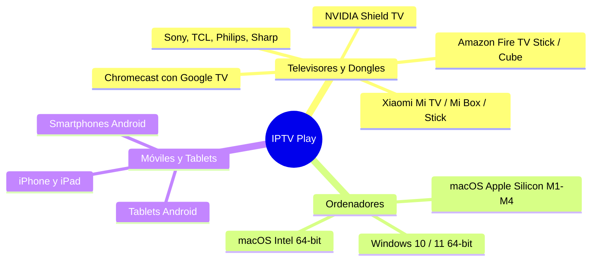

<div align="center">

# 📺 IPTV Play • Guía de Compatibilidad

**Matriz oficial de dispositivos, sistemas operativos, versiones mínimas y formatos de instalación.**

[](https://android.com/tv/)
[](https://amazon.es/firetv)
[](https://apple.com/macos)
[](https://microsoft.com/windows)

---

</div>

## 🌐 1. Dispositivos y Plataformas Admitidas

> [!TIP]
> **IPTV Play** incluye una interfaz adaptada para televisores (**10-Foot UI**), con foco visual inteligente y soporte completo para mandos a distancia estándar.



---

### 📋 Matriz de Soporte Detallada

| Plataforma | Dispositivos Clave | Sistema Mínimo | Arquitectura | Archivo / Instalador |
| :--- | :--- | :---: | :---: | :--- |
| **Android TV & Google TV** | • **Xiaomi:** Mi TV, Mi Box S, TV Stick<br>• **Google:** Chromecast con Google TV<br>• **Sony:** Bravia con Google TV<br>• **TCL, Philips, Sharp, Thomson**<br>• **NVIDIA:** Shield TV Pro | `Android 5.0`<br>*(API 21+)* | `arm64-v8a`<br>`armeabi-v7a`<br>`x86_64` | `app-release.apk`<br>*(Directo en pendrive o Downloader)* |
| **Amazon Fire TV** | • **Fire TV Stick** (Lite, HD, 4K, 4K Max)<br>• **Fire TV Cube**<br>• Smart TVs con Fire OS integrado | `Fire OS 6.0+`<br>*(Android 7.1+)* | `arm64-v8a`<br>`armeabi-v7a` | `app-release.apk`<br>*(Instalación rápida por Sideload)* |
| **Apple Mac** | • **Apple Silicon:** M1, M2, M3, M4 (Pro / Max)<br>• **Intel:** Cualquier Mac 64-bit | `macOS 11.0`<br>*(Big Sur o sup.)* | **Universal**<br>`arm64` + `x86_64` | `IPTV Play.app` o `.zip`<br>*(Autocontenido con mpv y codecs)* |
| **PC Windows** | • Sobremesa, portátiles, mini PCs y Surface | `Windows 10 / 11`<br>*(64-bit)* | `x64` | Carpeta ejecutable / `.exe` |
| **Móviles y Tablets** | • Dispositivos Samsung, Xiaomi, Pixel, etc.<br>• iPhone y iPad | `Android 5.0+`<br>`iOS 12.0+` | `arm64` | • Android: `app-release.apk`<br>• iOS: Proyecto compilable en Xcode |

---

## 🎮 2. Compatibilidad con el Mando a Distancia (Control Remoto)

La interfaz de televisión responde automáticamente a la cruceta y botones multimedia de cualquier mando Bluetooth o infrarrojo:

```
                  ┌───────────────┐
                  │   ▲  ARRIBA   │  --> Navegar categorías / Subir volumen
  ┌───────────────┼───────────────┼───────────────┐
  │   ◄ IZQUIERDA │  ●  OK/SELECT │  ►  DERECHA   │  --> Abrir canal / Pausar / Adelantar 10s
  └───────────────┼───────────────┼───────────────┘
                  │   ▼   ABAJO   │  --> Navegar canales / Bajar volumen
                  └───────────────┘
                     [ ↩ ATRÁS ]     --> Salir del reproductor / Volver
```

* 🌟 **Realce visual (Glow Effect):** El elemento seleccionado aumenta de tamaño un **105%** y se ilumina con un borde cian neón (`#00E5FF`).
* 📜 **Autodesplazamiento:** Al desplazarte por listas largas, la pantalla hace scroll automático suave sin saltos bruscos.
* ⌨️ **Mapeo de teclas estándar:**
  * <kbd>▲</kbd> / <kbd>▼</kbd> / <kbd>◄</kbd> / <kbd>►</kbd> : Mover foco en la cuadrícula o lista.
  * <kbd>OK</kbd> / <kbd>Enter</kbd> / <kbd>Botón A</kbd> : Selección y reproducción.
  * <kbd>Play</kbd> / <kbd>Pause</kbd> / <kbd>Espacio</kbd> : Control directo del reproductor.
  * <kbd>Atrás</kbd> / <kbd>Esc</kbd> : Regresar al menú anterior.

---

## ⚠️ 3. Dispositivos NO Compatibles Nativamente

> [!IMPORTANT]
> Los siguientes sistemas **no pueden ejecutar archivos `.apk` ni binarios de Flutter** debido a restricciones de sus propios fabricantes:

### 🍏 Apple TV (tvOS)
* **¿Por qué no funciona?:** Apple bloquea tecnologías como JIT y el motor oficial de Flutter no tiene soporte para la plataforma tvOS.
* **Solución alternativa:** Haz streaming mediante **AirPlay** desde tu Mac, iPhone o iPad hacia el Apple TV.

### 📺 Smart TVs de LG (webOS)
* **¿Por qué no funciona?:** Las televisiones LG utilizan el sistema webOS (HTML5/Enact) y no admiten aplicaciones de Android (`.apk`).
* **Solución recomendada:** Conecta un **Xiaomi TV Stick 4K** o **Fire TV Stick** a cualquier puerto HDMI de la tele.

### 📺 Smart TVs de Samsung (Tizen)
* **¿Por qué no funciona?:** Samsung utiliza su propio sistema operativo Tizen, incompatible con el instalador de Android.
* **Solución recomendada:** Utilizar un dispositivo HDMI externo con Android TV o Google TV.
