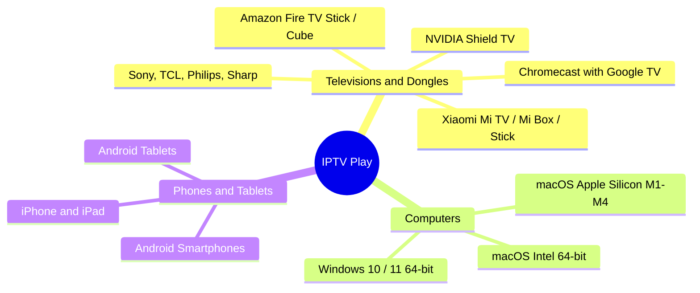

<div align="center">

# 📺 IPTV Play • Compatibility Guide

**Official matrix of supported devices, operating systems, minimum versions, and deployment formats.**

[](https://android.com/tv/)
[](https://amazon.com/firetv)
[](https://apple.com/macos)
[](https://microsoft.com/windows)

---

</div>

## 🌐 1. Supported Devices and Platforms

> [!TIP]
> **IPTV Play** features a dedicated 10-Foot UI for televisions, featuring smart visual focus indicators and full standard D-Pad remote control support.



---

### 📋 Detailed Support Matrix

| Platform | Key Devices | Minimum OS | Architecture | File / Installer |
| :--- | :--- | :---: | :---: | :--- |
| **Android TV & Google TV** | • **Xiaomi:** Mi TV, Mi Box S, TV Stick<br>• **Google:** Chromecast with Google TV<br>• **Sony:** Bravia with Google TV<br>• **TCL, Philips, Sharp, Thomson**<br>• **NVIDIA:** Shield TV Pro | `Android 5.0`<br>*(API 21+)* | `arm64-v8a`<br>`armeabi-v7a`<br>`x86_64` | `app-release.apk`<br>*(Direct via USB drive or Downloader app)* |
| **Amazon Fire TV** | • **Fire TV Stick** (Lite, HD, 4K, 4K Max)<br>• **Fire TV Cube**<br>• Smart TVs with integrated Fire OS | `Fire OS 6.0+`<br>*(Android 7.1+)* | `arm64-v8a`<br>`armeabi-v7a` | `app-release.apk`<br>*(Fast sideload install)* |
| **Apple Mac** | • **Apple Silicon:** M1, M2, M3, M4 (Pro / Max)<br>• **Intel:** Any 64-bit Mac | `macOS 11.0`<br>*(Big Sur or newer)* | **Universal**<br>`arm64` + `x86_64` | `IPTV Play.app` or `.zip`<br>*(Self-contained with mpv engine and codecs)* |
| **Windows PC** | • Desktops, laptops, mini PCs, and Surface | `Windows 10 / 11`<br>*(64-bit)* | `x64` | Executable directory / `.exe` |
| **Phones and Tablets** | • Samsung, Xiaomi, Pixel devices, etc.<br>• iPhone and iPad | `Android 5.0+`<br>`iOS 12.0+` | `arm64` | • Android: `app-release.apk`<br>• iOS: Xcode buildable project |

---

## 🎮 2. Remote Control Compatibility (D-Pad & 10-Foot UI)

The television interface automatically listens and responds to direction pads and multimedia keys across Bluetooth and IR remotes:

```
                  ┌───────────────┐
                  │   ▲    UP     │  --> Navigate categories / Increase volume
  ┌───────────────┼───────────────┼───────────────┐
  │   ◄  LEFT     │  ●  OK/SELECT │  ►   RIGHT    │  --> Open channel / Pause / Seek 10s
  └───────────────┼───────────────┼───────────────┘
                  │   ▼   DOWN    │  --> Navigate channels / Decrease volume
                  └───────────────┘
                     [ ↩ BACK ]      --> Exit player / Return to previous view
```

* 🌟 **Glow Effect:** Focused elements scale up by **105%** and illuminate with a vibrant cyan neon border (`#00E5FF`).
* 📜 **Smooth Auto-Scroll:** While scrolling through long lists, the screen scrolls smoothly without jarring transitions.
* ⌨️ **Standard Key Bindings:**
  * <kbd>▲</kbd> / <kbd>▼</kbd> / <kbd>◄</kbd> / <kbd>►</kbd> : Move focus across grid or list items.
  * <kbd>OK</kbd> / <kbd>Enter</kbd> / <kbd>Gamepad Button A</kbd> : Select and play.
  * <kbd>Play</kbd> / <kbd>Pause</kbd> / <kbd>Space</kbd> : Direct player controls.
  * <kbd>Back</kbd> / <kbd>Esc</kbd> : Return to previous view.

---

## ⚠️ 3. Natively Unsupported Devices

> [!IMPORTANT]
> The following systems **cannot run Android `.apk` files or Flutter native desktop binaries** due to vendor restrictions:

### 🍏 Apple TV (tvOS)
* **Why not supported?:** Apple blocks technologies like JIT and the official Flutter engine does not provide a tvOS runner.
* **Workaround:** Stream via **AirPlay** from your Mac, iPhone, or iPad to your Apple TV.

### 📺 LG Smart TVs (webOS)
* **Why not supported?:** LG TVs run webOS (HTML5/Enact) and do not support Android applications (`.apk`).
* **Recommended solution:** Connect a **Xiaomi TV Stick 4K** or **Fire TV Stick** to any HDMI port.

### 📺 Samsung Smart TVs (Tizen)
* **Why not supported?:** Samsung runs proprietary Tizen OS, incompatible with Android packages.
* **Recommended solution:** Use an external HDMI dongle running Android TV or Google TV.
