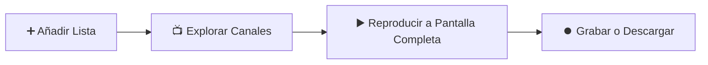

<div align="center">

# 📖 Manual de Usuario • IPTV Play

**Aprende a configurar y disfrutar de tus canales, películas y series en menos de 3 minutos.**

[](https://github.com)
[](https://github.com)
[](https://github.com)

---

</div>

## 🚀 Flujo Rápido de Inicio



---

## 📑 Índice de Secciones

1. [Paso 1: Añadir tu Lista de Canales](#-paso-1-añadir-tu-lista-de-canales)
2. [Paso 2: Ver Televisión en Directo (Live TV)](#-paso-2-ver-televisión-en-directo-live-tv)
3. [Paso 3: Películas y Series a la Carta (VOD)](#-paso-3-películas-y-series-a-la-carta-vod)
4. [Paso 4: Grabaciones (PVR) y Descargas Offline](#-paso-4-grabaciones-pvr-y-descargas-offline)
5. [Paso 5: Cómo Usar el Mando a Distancia en la Tele](#-paso-5-cómo-usar-el-mando-a-distancia-en-la-tele)
6. [Atajos de Teclado Útiles](#-atajos-de-teclado-útiles)

---

## 🔌 Paso 1: Añadir tu Lista de Canales

Al abrir la aplicación por primera vez, verás la opción de vincular tu proveedor:

1. Pulsa en el botón **`+ Añadir lista`** situado en la barra lateral izquierda (o pulsa sobre la tarjeta del perfil activo).
2. Elige el formato que te haya proporcionado tu proveedor IPTV:

```
┌──────────────────────────────────────┐     ┌──────────────────────────────────────┐
│       OPCIÓN A: Enlace M3U / URL      │     │      OPCIÓN B: Xtream Codes API      │
├──────────────────────────────────────┤     ├──────────────────────────────────────┤
│ 1. Nombre: Mi Lista Personal         │     │ 1. Nombre: Proveedor Xtream          │
│ 2. URL M3U: http://mi-servidor...    │     │ 2. Servidor: http://servidor.com:80  │
│                                      │     │ 3. Usuario: tu_usuario               │
│                                      │     │ 4. Contraseña: ••••••••              │
└──────────────────────────────────────┘     └──────────────────────────────────────┘
```

3. Pulsa el botón **"Guardar y Cargar"**.
4. ¡Listo! En unos segundos se descargarán automáticamente los canales, los logotipos y la guía electrónica de programación (**EPG**).

> [!TIP]
> Puedes tener **múltiples listas guardadas** simultáneamente. Para cambiar de una lista a otra, simplemente pulsa en la tarjeta de perfil arriba a la izquierda.

---

## 📺 Paso 2: Ver Televisión en Directo (Live TV)

1. En el menú de la izquierda, entra en **"TV en Vivo"**.
2. **Explorador de Categorías:**
   * En la barra lateral encontrarás los grupos organizados (*Deportes, Cine, Documentales, Noticias, etc.*).
   * Arriba del todo siempre tendrás a mano tus **⭐ Favoritos** y tus **🕒 Canales Recientes**.
3. **Buscar Canal:** Usa la barra de búsqueda superior para encontrar cualquier canal escribiendo su nombre.
4. **Reproducir:** Haz clic o pulsa <kbd>OK</kbd> sobre cualquier canal para abrirlo en el reproductor a pantalla completa.
5. **Guía de Programación (EPG):** Junto a cada canal verás qué programa se está emitiendo ahora mismo y una barra de progreso. Pulsa el icono del calendario <kbd>📅</kbd> para consultar la programación de las próximas horas.

---

## 🎬 Paso 3: Películas y Series a la Carta (VOD)

1. Selecciona **"Películas (VOD)"** o **"Series"** en el menú principal.
2. Navega por las carátulas con sus notas de valoración de la comunidad y categorías.
3. **Detalles y Sinopsis:** Pulsa sobre cualquier título para abrir su ficha completa con argumento, año y duración.
4. **En las Series:** Puedes desplegar las temporadas y elegir cualquier episodio individual.
5. **Reanudación Automática:** Si dejas una película o serie a medias, la app guardará el punto exacto y te lo mostrará en la fila superior **"Continuar viendo"**.

---

## ⏺️ Paso 4: Grabaciones (PVR) y Descargas Offline

* **🔴 Grabar un directo (PVR):** Mientras estás viendo un canal, pulsa el botón redondo de grabación **REC**. La emisión se guardará en segundo plano en tu disco local. Pulsa de nuevo para detener la grabación.
* **💾 Descargar películas o episodios:** En la ficha de cualquier película o episodio, pulsa **"Descargar"**. Podrás verla aunque te quedes sin conexión a internet.
* **📂 Administrar contenidos:** Entra en la sección **"Descargas & PVR"** del menú para reproducir tus contenidos grabados, reanudar descargas o liberar espacio.

> [!NOTE]
> Las descargas de películas soportan **reanudación inteligente**: si se corta la conexión WiFi o apagas el equipo, se retomará desde el punto exacto sin volver a descargar desde cero.

---

## 🎮 Paso 5: Cómo Usar el Mando a Distancia en la Tele

Si instalas la app en una Smart TV (Xiaomi, Fire TV Stick, Google TV, Sony, TCL, etc.):

| Botón del Mando | Función en la Aplicación |
| :---: | :--- |
| <kbd>▲</kbd> <kbd>▼</kbd> <kbd>◄</kbd> <kbd>►</kbd><br>*(Cruceta D-Pad)* | **Navegar:** Moverte entre menús, canales y películas. El elemento activo se ilumina en **cian brillante** y aumenta de tamaño. |
| <kbd>OK</kbd> / <kbd>Enter</kbd> | **Seleccionar:** Abre el canal o reproduce el vídeo enfocado. |
| <kbd>OK</kbd><br>*(Dentro del vídeo)* | **Controles:** Muestra u oculta la barra de tiempo y pausa/reanuda el vídeo. |
| <kbd>◄</kbd> / <kbd>►</kbd><br>*(Dentro del vídeo)* | **Rebobinar / Avanzar:** Salta 10 segundos atrás o adelante en el vídeo. |
| <kbd>▲</kbd> / <kbd>▼</kbd><br>*(Dentro del vídeo)* | **Volumen:** Sube o baja el nivel de sonido. |
| <kbd>↩ Volver</kbd> / <kbd>Back</kbd> | **Atrás:** Sale del reproductor o vuelve a la pantalla previa. |

---

## ⌨️ Atajos de Teclado Útiles (Ordenador / Mac / PC)

| Tecla | Acción |
| :---: | :--- |
| <kbd>F</kbd> | Activar o salir del modo **Pantalla Completa** |
| <kbd>Espacio</kbd> | **Pausar / Reanudar** la reproducción |
| <kbd>M</kbd> | **Silenciar** o activar sonido (Mute) |
| <kbd>Esc</kbd> | Cerrar reproductor / Salir de pantalla completa |
| <kbd>→</kbd> / <kbd>←</kbd> | Avanzar o retroceder 10 segundos |
| <kbd>↑</kbd> / <kbd>↓</kbd> | Subir o bajar el volumen |

---

<div align="center">

**IPTV Play** • Desarrollado con ❤️ para disfrutar de la mejor televisión.

</div>
