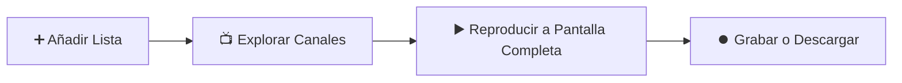
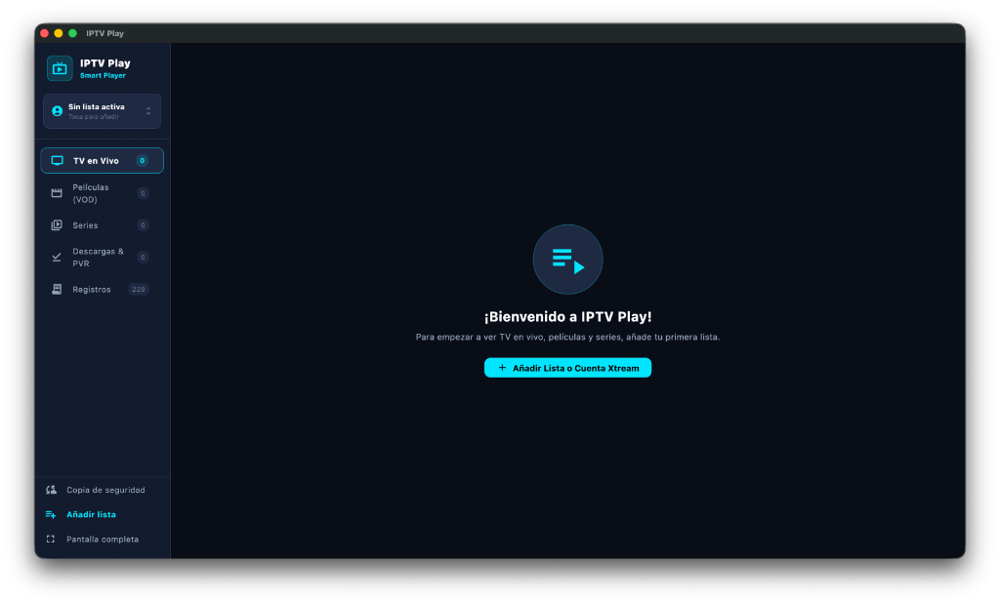
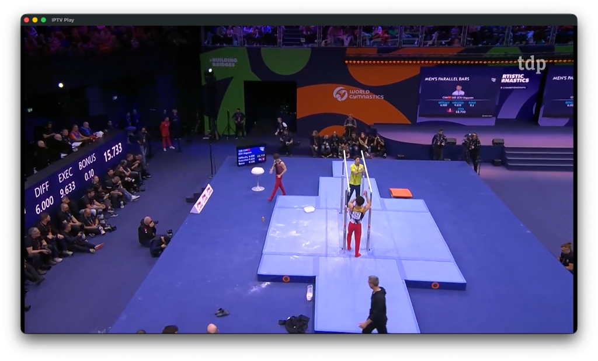

<div align="center">

# 📖 Manual de Usuario • IPTV Play

**Aprende a configurar y disfrutar de tus canales, películas y series en menos de 3 minutos.**

[](https://github.com)
[](https://github.com)
[](https://github.com)

---

</div>

## 🚀 Flujo Rápido de Inicio



---

## 📑 Índice de Secciones

1. [Paso 1: Añadir tu Lista de Canales](#-paso-1-añadir-tu-lista-de-canales)
2. [Paso 2: Inicio (Home Hub) y TV en Directo](#-paso-2-inicio-home-hub-y-tv-en-directo)
3. [Paso 3: Multiview (Pantalla Dividida hasta 4 Canales)](#-paso-3-multiview-pantalla-dividida-hasta-4-canales)
4. [Paso 4: Guía EPG en Cuadrícula y Recordatorios](#-paso-4-guía-epg-en-cuadrícula-y-recordatorios)
5. [Paso 5: Subtítulos Externos y Audio Dual Avanzado](#-paso-5-subtítulos-externos-y-audio-dual-avanzado)
6. [Paso 6: Control Parental y Modo Infantil](#-paso-6-control-parental-y-modo-infantil)
7. [Paso 7: Películas y Series a la Carta (VOD)](#-paso-7-películas-y-series-a-la-carta-vod)
8. [Paso 8: Grabaciones (PVR) y Descargas Offline](#-paso-8-grabaciones-pvr-y-descargas-offline)
9. [Paso 9: Copias de Seguridad Cifradas (AES-256)](#-paso-9-copias-de-seguridad-cifradas-aes-256)
10. [Mando de Smart TV y Atajos de Teclado](#-mando-de-smart-tv-y-atajos-de-teclado)

---

## 🔌 Paso 1: Añadir tu Lista de Canales

Al abrir la aplicación por primera vez, verás la opción de vincular tu proveedor:

1. Pulsa en la sección **Configuración** en la barra lateral izquierda (o pulsa sobre la tarjeta del perfil activo) y selecciona **+ Añadir Lista**.
2. Elige el formato que te haya proporcionado tu proveedor IPTV:

```
┌──────────────────────────────────────┐     ┌──────────────────────────────────────┐
│       OPCIÓN A: Enlace M3U / URL      │     │      OPCIÓN B: Xtream Codes API      │
├──────────────────────────────────────┤     ├──────────────────────────────────────┤
│ 1. Nombre: Mi Lista Personal         │     │ 1. Nombre: Proveedor Xtream          │
│ 2. URL M3U: http://mi-servidor...    │     │ 2. Servidor: http://servidor.com:80  │
│                                      │     │ 3. Usuario: tu_usuario               │
│                                      │     │ 4. Contraseña: ••••••••              │
└──────────────────────────────────────┘     └──────────────────────────────────────┘
```

3. Pulsa el botón **"Guardar y Cargar"**.
4. ¡Listo! Las contraseñas quedan protegidas automáticamente mediante cifrado por hardware en Keychain/Keystore.

<div align="center">
  
</div>

---

## 🏠 Paso 2: Inicio (Home Hub) y TV en Directo

1. **Pantalla de Inicio ("Home Hub"):** Centro de contenidos estilo Netflix / Plex:
   * **Banner Destacado:** Grandes estrenos y eventos deportivos destacados.
   * **Continuar Viendo:** Retoma películas y series con barra de progreso y minutos restantes.
   * **Canales Favoritos:** Vista previa con el programa que se está emitiendo en directo ahora mismo.
   * **Recordatorios de Emisión:** Próximos programas agendados con cuenta atrás.
2. **TV en Directo y Espacio Maximizado:**
   * Organiza canales por categorías, favoritos o recientes.
   * **Ocultar/Mostrar Menú Izquierdo:** Pulsa el icono colapsar (`Icons.menu_open`) en la parte superior del menú o el botón flotante `Menú` para ver más contenido en pantalla.
   * **Ocultar/Mostrar Submenú de Categorías:** Pulsa el botón de panel lateral (`<` / icono de barra lateral) en la cabecera para ocultar el listado de categorías y expandir la cuadrícula de canales a pantalla completa.
   * **Búsqueda por Voz:** Pulsa el icono de micrófono para dictar títulos o géneros con el mando.
   * Pulsa cualquier canal para reproducirlo a pantalla completa.

<div align="center">
  
</div>

---

## 🔲 Paso 3: Multiview (Pantalla Dividida hasta 4 Canales)

Disfruta de varios partidos o eventos en directo de forma simultánea:
1. En la pantalla de TV en Vivo, pulsa el botón **"Multiview"**.
2. Elige la distribución deseada (cuadrícula 2x2 o división 2x1).
3. Añade hasta 4 canales simultáneos.
4. **Foco de Audio Inteligente:** Con la cruceta del mando (D-Pad), desplázate a cualquier cuadrícula para escuchar su audio al instante sin detener la imagen de las demás.

---

## 📅 Paso 4: Guía EPG en Cuadrícula y Recordatorios

1. Pulsa **"Guía TV"** para abrir la cuadrícula tradicional tipo decodificador de satélite o cable.
2. Navega horizontalmente por bloques de 30 minutos coordinados con la línea cian "AHORA".
3. Pulsa sobre cualquier programa futuro para activar un **Recordatorio de Emisión**.
4. Al comenzar el programa, aparecerá una alerta emergente con el botón **"VER AHORA"** para sintonizar el canal en 1 clic.

---

## 💬 Paso 5: Subtítulos Externos y Audio Dual Avanzado

1. Durante la reproducción, pulsa el icono de **Subtítulos**:
   * **Buscar en Línea:** Descarga subtítulos en español o cualquier idioma vía OpenSubtitles.
   * **Archivo Local:** Carga archivos `.srt` o `.vtt` almacenados en tu televisor o disco.
2. Pulsa el icono de **Audio** para elegir la pista deseada con banderas de idioma e insignias de calidad (`DOLBY ATMOS`, `5.1 SURROUND`, `STEREO`).

---

## 🛡️ Paso 6: Control Parental y Modo Infantil

1. Accede a **"Control Parental"** en la barra de navegación.
2. Configura un PIN de 4 dígitos usando el teclado físico o el **Teclado Numérico Virtual** en pantalla con el mando.
3. Elige tus preferencias:
   * **Ocultar adultos:** Bloquea y esconde automáticamente canales y películas (+18 / XXX).
   * **Bloquear Ajustes:** Requiere el PIN para editar o borrar perfiles y realizar copias de seguridad.

---

## 🎬 Paso 7: Películas y Series a la Carta (VOD)

1. Selecciona **"Películas (VOD)"** o **"Series"** en el menú principal.
2. Navega por las carátulas con sus notas de valoración de la comunidad y categorías.
3. **Detalles y Sinopsis:** Pulsa sobre cualquier título para abrir su ficha completa con argumento, año y duración.
4. **En las Series:** Puedes desplegar las temporadas y elegir cualquier episodio individual.

---

## ⏺️ Paso 8: Grabaciones (PVR) y Descargas Offline

* **🔴 Grabar un directo (PVR):** Mientras estás viendo un canal, pulsa el botón redondo de grabación **REC**. La emisión se guardará en segundo plano en tu disco local.
* **💾 Descargar películas o episodios:** En la ficha de cualquier película o episodio, pulsa **"Descargar"**. La descarga inteligente por rangos HTTP asegura que nunca empiece de cero si se corta el WiFi.
* **📂 Administrar contenidos:** Entra en la sección **"Descargas & PVR"** para reproducir o borrar tus archivos guardados.

---

## 💾 Paso 9: Copias de Seguridad Cifradas (AES-256)

1. En el gestor de perfiles, entra en **"Copia de Seguridad"**.
2. Para salvaguardar tus credenciales, introduce una contraseña opcional y el archivo `.json` se exportará cifrado con **AES-256 GCM**.
3. Restaura tu copia de seguridad en cualquier otro televisor o dispositivo.

---

## 🎮 Mando de Smart TV y Atajos de Teclado

### Mando a Distancia (10-Foot UI):
| Botón del Mando | Función en la Aplicación |
| :---: | :--- |
| <kbd>▲</kbd> <kbd>▼</kbd> <kbd>◄</kbd> <kbd>►</kbd><br>*(Cruceta D-Pad)* | **Navegar:** Moverte entre menús, canales, cuadrícula Multiview y teclado de PIN. El elemento activo se ilumina en **cian brillante**. |
| <kbd>OK</kbd> / <kbd>Enter</kbd> | **Seleccionar:** Abre el canal o reproduce el vídeo enfocado. |
| <kbd>OK</kbd> *(Dentro del vídeo)* | **Controles:** Muestra u oculta la barra de tiempo y pausa/reanuda el vídeo. |
| <kbd>◄</kbd> / <kbd>►</kbd> *(Dentro del vídeo)* | **Rebobinar / Avanzar:** Salta 10 segundos atrás o adelante en el vídeo. |
| <kbd>▲</kbd> / <kbd>▼</kbd> *(Dentro del vídeo)* | **Volumen:** Sube o baja el nivel de sonido. |
| <kbd>↩ Volver</kbd> / <kbd>Back</kbd> | **Atrás:** Sale del reproductor o vuelve a la pantalla previa. |

### Atajos de Teclado Útiles (Mac & PC):
| Tecla | Acción |
| :---: | :--- |
| <kbd>F</kbd> | Activar o salir del modo **Pantalla Completa** |
| <kbd>I</kbd> | Activar o desactivar el **HUD de Estadísticas en Vivo** (bitrate, fps, códec, fotogramas perdidos) |
| <kbd>Espacio</kbd> | **Pausar / Reanudar** la reproducción |
| <kbd>M</kbd> | **Silenciar** o activar sonido (Mute) |
| <kbd>Esc</kbd> | Cerrar reproductor / Salir de pantalla completa |
| <kbd>→</kbd> / <kbd>←</kbd> | Avanzar o retroceder 10 segundos |
| <kbd>↑</kbd> / <kbd>↓</kbd> | Subir o bajar el volumen |

---

<div align="center">

**IPTV Play** • Desarrollado con ❤️ para disfrutar de la mejor televisión.

</div>
