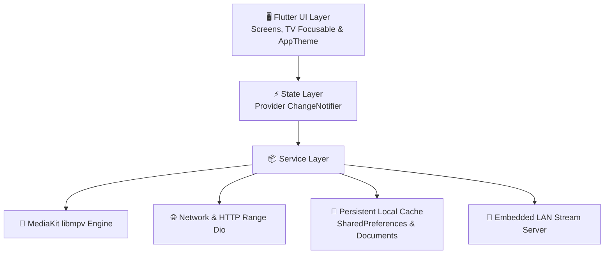

<div align="center">

# 📺 IPTV Play

**A modern, high-performance, cross-platform smart IPTV player built with Flutter and MediaKit (libmpv).**

[](https://flutter.dev)
[](https://dart.dev)
[](https://github.com)
[](COMPATIBILIDAD.md)
[](LICENSE)

[Español (README_ES.md)](README_ES.md) • [Compatibility Guide](COMPATIBILITY.md) • [User Manual](USER_MANUAL.md)

---

</div>

## 🌟 Highlights

* **Dual IPTV Protocol:** Full support for both **Xtream Codes API** and raw **M3U / M3U8** playlists.
* **10-Foot TV UI with Remote Navigation:** Intelligent D-Pad navigation, smooth focus scaling (1.05x), cyan glow outlines, and automatic scrolling for Smart TVs (Xiaomi, Fire TV Stick, Google TV, Sony, TCL).
* **Hardware-Accelerated Video Engine:** Powered by **MediaKit (libmpv)** with hardware decoding, sub-second zapping, multi-aspect ratio modes, and embedded audio/subtitle track selection.
* **Smart Offline Downloads & Live PVR:**
  * **Live TV Recording:** Capture live streams into playable MPEG-TS (`.ts`) files in background.
  * **Resumable HTTP Range VOD Downloads:** Pauses and resumes seamlessly (`206 Partial Content`) without restarting from byte zero on connection drops.
  * **Real-time Metrics:** Live speed meter (e.g. `4.2 MB/s`) and Estimated Time of Arrival (ETA).
* **Catch-up / Replay TV:** Browse and watch past 7 days broadcasts with Xtream timeshift.
* **XMLTV / EPG Program Guide:** High-speed XMLTV parser supporting `.xml` and compressed `.xml.gz` formats with persistent disk cache.
* **LAN Stream Relay Server:** Embedded local HTTP server on port `8088` to re-stream current playback across other devices on the same local network without extra IPTV connections.
* **TheMovieDatabase (TMDB) Integration:** Automatic movie/series enrichment with plot synopses, community ratings, release dates, and high-definition posters.
* **Local Privacy First:** Zero telemetry; all server credentials, playlists, and watch history stay strictly local on device.

---

## 🏛️ System Architecture



---

## 🎮 Smart TV & Remote Control (10-Foot UI)

IPTV Play is optimized for both desktop mice and armchair remote control interaction:

```
                  ┌───────────────┐
                  │   ▲   UP      │  --> Navigate categories / Volume up
  ┌───────────────┼───────────────┼───────────────┐
  │   ◄  LEFT     │  ●  OK/SELECT │  ►   RIGHT    │  --> Select / Pause / Seek 10s
  └───────────────┼───────────────┼───────────────┘
                  │   ▼  DOWN     │  --> Navigate channels / Volume down
                  └───────────────┘
                     [ ↩ BACK ]      --> Exit player / Return
```

* **Focus Glow (`TvFocusable`):** Selected items expand smoothly and glow with high-contrast cyan highlight.
* **Remote Shortcuts:** Direct response to `Select`, `Enter`, `Play`, `Pause`, `FastForward`, `Rewind`, and `Back`.

---

## 🧪 Comprehensive Test Suite

IPTV Play contains extensive automated tests validating **real business logic and behavior**:

```bash
flutter test
```

### Verified Coverage:
* ✅ **M3U Parser Service (`test/m3u_parser_test.dart`):** Real regex parsing of `#EXTINF`, live channel categorization, VOD file extension detection (`.mp4`, `.mkv`), and series detection.
* ✅ **TV Focusable Widget (`test/tv_focusable_test.dart`):** Simulates hardware D-Pad key events (`LogicalKeyboardKey.select`, `enter`, `space`), autofocus activation, and dynamic focus styling.
* ✅ **User Activity & Persistence (`test/user_activity_test.dart`):** Tests reactive favorite toggling, recents stack management (LIFO ordering), and continue watching playback progress persistence.
* ✅ **Domain Models (`test/models_test.dart`):** Validates Xtream JSON conversions, time range formatting, download speed math, and EPG airing state calculations.

---

## 🚀 Getting Started

### Prerequisites
* **Flutter SDK:** `^3.13.1` or higher.
* **macOS:** Xcode with CocoaPods.
* **Android / Fire TV:** Android SDK with platform tools.
* **Windows:** Visual Studio 2022 with *Desktop development with C++*.

### 1. Installation
```bash
# Clone the repository
git clone <repository-url>
cd iptvexp

# Install dependencies
flutter pub get
```

### 2. Run Locally
```bash
# Run on macOS desktop
flutter run -d macos

# Run on Android / Android TV device
flutter run -d <device-id>
```

### 3. Build Production Releases

#### 🍏 macOS (Universal Binary x86_64 + arm64)
```bash
flutter build macos --release
```
Output: `build/macos/Build/Products/Release/IPTV Play.app`

#### 📺 Android TV & Fire TV Stick
```bash
flutter build apk --release
```
Output: `build/app/outputs/flutter-apk/app-release.apk`

---

## 📁 Project Structure

```text
lib/
├── main.dart                       # App entry point & MultiProvider registration
├── models/                         # Domain models (Channel, Vod, Series, EPG, Downloads)
├── providers/                      # Reactive state managers (Catalog, Downloads, EPG, Player)
├── services/                       # Network, parsers, libmpv player & local storage
└── ui/                             # Views and presentation layer
    ├── screens/                    # Main views (Live TV, VOD, Series, Player, Downloads)
    ├── theme/                      # Premium Dark Theme color tokens
    └── widgets/                    # Reusable components (TvFocusable, MiniplayerBar, EPG dialogs)
```

---

## 🔒 Privacy & Security

* **100% Local Privacy:** Playlists, credentials, EPG databases, and downloaded videos are kept locally on device. No telemetry or analytics are sent to external services.
* **Encrypted Credential Storage (Hardware Keystore / Keychain):** Sensitive credentials (such as Xtream account passwords) should be secured using hardware-backed storage (`flutter_secure_storage` via Apple Keychain and Android Keystore) rather than unencrypted plain local storage.
* **Strict URL Sanitization & SSRF Protection:** Network requests strictly validate that URLs begin exclusively with `http://` or `https://` (disallowing dangerous schemes like `file://`, `javascript://`, or `content://`), and enforce anti-SSRF policies blocking rogue redirects to loopback/local IPs (`localhost`, `127.0.0.1`, `::1`, cloud metadata endpoints) from the HTTP client.
* **Secure Sandbox:** macOS App Sandbox entitlements strictly limit access to network sockets and user-selected files.

---

## 📚 Documentation
* 📱 **[Compatibility Guide (COMPATIBILITY.md)](COMPATIBILITY.md):** Supported devices and TV OS matrix.
* 📖 **[User Manual (USER_MANUAL.md)](USER_MANUAL.md):** 5-step quick onboarding manual.
* 🤖 **[Agent Guidelines (AGENTS_EN.md)](AGENTS_EN.md):** Architecture and engineering standards.
* 🇪🇸 **[Spanish Documentation (README_ES.md)](README_ES.md):** Documentación completa en español.
