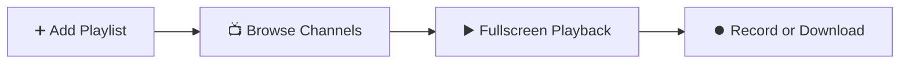

<div align="center">

# 📖 User Manual • IPTV Play

**Learn how to configure and enjoy your live TV channels, movies, and series in under 3 minutes.**

[](https://github.com)
[](https://github.com)
[](https://github.com)

---

</div>

## 🚀 Quick Start Workflow



---

## 📑 Table of Contents

1. [Step 1: Add your IPTV Playlist](#-step-1-add-your-iptv-playlist)
2. [Step 2: Watch Live Television (Live TV)](#-step-2-watch-live-television-live-tv)
3. [Step 3: On-Demand Movies and Series (VOD)](#-step-3-on-demand-movies-and-series-vod)
4. [Step 4: PVR Recordings and Offline Downloads](#-step-4-pvr-recordings-and-offline-downloads)
5. [Step 5: Using Remote Control on Smart TV](#-step-5-using-remote-control-on-smart-tv)
6. [Helpful Keyboard Shortcuts](#-helpful-keyboard-shortcuts)

---

## 🔌 Step 1: Add your IPTV Playlist

When launching the application for the first time, you will be prompted to add your playlist:

1. Click on the **`+ Add Playlist`** button in the left sidebar (or click the active profile card at the top).
2. Choose the format provided by your IPTV service provider:

```
┌──────────────────────────────────────┐     ┌──────────────────────────────────────┐
│       OPTION A: M3U Link / URL       │     │      OPTION B: Xtream Codes API      │
├──────────────────────────────────────┤     ├──────────────────────────────────────┤
│ 1. Name: My Playlist                 │     │ 1. Name: Xtream Provider             │
│ 2. M3U URL: http://my-server...      │     │ 2. Server: http://server.com:80      │
│                                      │     │ 3. Username: your_username           │
│                                      │     │ 4. Password: ••••••••                │
└──────────────────────────────────────┘     └──────────────────────────────────────┘
```

3. Click **"Save and Load"**.
4. That's it! Channels, logos, and Electronic Program Guide (**EPG**) will load in seconds.

> [!TIP]
> You can save **multiple playlists** simultaneously. To switch between profiles, click the profile card in the top-left corner.

---

## 📺 Step 2: Watch Live Television (Live TV)

1. Select **"Live TV"** from the left navigation menu.
2. **Category Browser:**
   * Organize channels by groups (*Sports, Movies, Documentaries, News, etc.*) in the sidebar.
   * Access your **⭐ Favorites** and **🕒 Recent Channels** at the top.
3. **Channel Search:** Use the search bar to find any channel by name.
4. **Play:** Click or press <kbd>OK</kbd> on any channel to launch fullscreen playback.
5. **Program Guide (EPG):** Each channel displays the current airing show and a live progress bar. Click the calendar icon <kbd>📅</kbd> to inspect the full schedule.

---

## 🎬 Step 3: On-Demand Movies and Series (VOD)

1. Select **"Movies (VOD)"** or **"Series"** in the main menu.
2. Browse posters with community ratings and genres.
3. **Details & Plot:** Click any title to view synopsis, release year, duration, and metadata.
4. **Series Navigation:** Browse seasons and pick any episode with title and thumbnail.
5. **Resume Watching:** If you stop mid-playback, IPTV Play remembers the exact timestamp in the **"Continue Watching"** shelf.

---

## ⏺️ Step 4: PVR Recordings and Offline Downloads

* **🔴 Record Live TV (PVR):** While watching a channel, click the red **REC** button. The stream records in the background to local disk as a playable MPEG-TS file. Click again to stop.
* **💾 Download Movies or Episodes:** In the details sheet, click **"Download"**. Watch offline anytime without an internet connection.
* **📂 Manage Media:** Navigate to **"Downloads & PVR"** to play recordings, resume downloads, or free up disk space.

> [!NOTE]
> Video downloads support **smart resumable HTTP Range requests**: if the connection drops or the app restarts, downloads continue from the exact byte offset without starting over.

---

## 🎮 Step 5: Using Remote Control on Smart TV

If installed on a Smart TV (Xiaomi, Fire TV Stick, Google TV, Sony, TCL, etc.):

| Remote Button | App Function |
| :---: | :--- |
| <kbd>▲</kbd> <kbd>▼</kbd> <kbd>◄</kbd> <kbd>►</kbd><br>*(D-Pad)* | **Navigate:** Move between menus, channels, and cards. Active item scales up with a **cyan glow**. |
| <kbd>OK</kbd> / <kbd>Enter</kbd> | **Select:** Open channel or start video playback. |
| <kbd>OK</kbd><br>*(During playback)* | **Controls:** Show/hide player overlay and pause/resume. |
| <kbd>◄</kbd> / <kbd>►</kbd><br>*(During playback)* | **Rewind / Fast Forward:** Jump 10 seconds back or ahead. |
| <kbd>▲</kbd> / <kbd>▼</kbd><br>*(During playback)* | **Volume:** Adjust sound levels. |
| <kbd>↩ Back</kbd> | **Return:** Exit player or return to previous screen. |

---

## ⌨️ Helpful Keyboard Shortcuts (Mac & PC)

| Key | Action |
| :---: | :--- |
| <kbd>F</kbd> | Toggle **Fullscreen** mode |
| <kbd>Space</kbd> | **Pause / Resume** playback |
| <kbd>M</kbd> | **Mute / Unmute** audio |
| <kbd>Esc</kbd> | Exit player / Leave fullscreen |
| <kbd>→</kbd> / <kbd>←</kbd> | Seek ahead / back 10 seconds |
| <kbd>↑</kbd> / <kbd>↓</kbd> | Volume up / down |

---

<div align="center">

**IPTV Play** • Crafted with ❤️ for the ultimate television experience.

</div>
