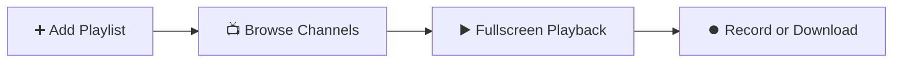

<div align="center">

# 📖 User Manual • IPTV Play

**Learn how to configure and enjoy your live TV channels, movies, and series in under 3 minutes.**

[](https://github.com)
[](https://github.com)
[](https://github.com)

---

</div>

## 🚀 Quick Start Workflow



---

## 📑 Table of Contents

1. [Step 1: Add your IPTV Playlist](#-step-1-add-your-iptv-playlist)
2. [Step 2: Home Hub & Live Television](#-step-2-home-hub--live-television)
3. [Step 3: Multiview (Split-screen 4 Channels)](#-step-3-multiview-split-screen-4-channels)
4. [Step 4: Traditional EPG Timeline & Reminders](#-step-4-traditional-epg-timeline--reminders)
5. [Step 5: External Subtitles & Advanced Audio](#-step-5-external-subtitles--advanced-audio)
6. [Step 6: Parental Control & Kids Mode](#-step-6-parental-control--kids-mode)
7. [Step 7: PVR Recordings and Offline Downloads](#-step-7-pvr-recordings-and-offline-downloads)
8. [Step 8: Encrypted Backups (AES-256)](#-step-8-encrypted-backups-aes-256)
9. [Smart TV Remote & Helpful Shortcuts](#-smart-tv-remote--helpful-shortcuts)

---

## 🔌 Step 1: Add your IPTV Playlist

When launching the application for the first time, you will be prompted to add your playlist:

1. Click on the **Settings** (`Configuración`) section in the left sidebar (or click the active profile card at the top) and select **+ Add Playlist**.
2. Choose the format provided by your IPTV service provider:

```
┌──────────────────────────────────────┐     ┌──────────────────────────────────────┐
│       OPTION A: M3U Link / URL       │     │      OPTION B: Xtream Codes API      │
├──────────────────────────────────────┤     ├──────────────────────────────────────┤
│ 1. Name: My Playlist                 │     │ 1. Name: Xtream Provider             │
│ 2. M3U URL: http://my-server...      │     │ 2. Server: http://server.com:80      │
│                                      │     │ 3. Username: your_username           │
│                                      │     │ 4. Password: ••••••••                │
└──────────────────────────────────────┘     └──────────────────────────────────────┘
```

3. Click **"Save and Load"**.
4. That's it! Passwords are automatically encrypted using hardware Keychain/Keystore.

<div align="center">
  
</div>

---

## 🏠 Step 2: Home Hub & Live Television

1. **Home Hub ("Inicio" tab):** Your personalized streaming center inspired by Netflix and Plex:
   * **Hero Spotlight Banner:** Promoted movies and top sports.
   * **Continue Watching:** Instant resume progress bar with remaining duration.
   * **Favorite Channels:** Instant preview with the live show currently airing.
   * **Broadcast Reminders:** Upcoming scheduled alerts with countdown.
2. **Live TV Screen & Maximized Space:**
   * Filter channels by category, favorites, or recent history.
   * **Collapse/Expand Left Menu:** Tap the collapse button (`Icons.menu_open`) in the sidebar header or the floating `Menu` button to maximize viewing space.
   * **Collapse/Expand Category Submenu:** Tap the sidebar toggle button (`<` / sidebar icon) in the header to hide the category panel and view the channel grid in full width.
   * **Voice Search:** Press the microphone icon to quickly search by title or genre.
   * Click any channel to play in full screen.

<div align="center">
  
</div>

---

## 🔲 Step 3: Multiview (Split-screen 4 Channels)

Follow multiple simultaneous matches or breaking news events:
1. In the Live TV screen, click the **"Multiview"** icon.
2. Choose your layout (2x2 grid or 2x1 split).
3. Add up to 4 concurrent channels.
4. **Audio Focus:** Move the D-Pad cursor over any channel to instantly route audio through your speakers without interrupting the other visual streams.

---

## 📅 Step 4: Traditional EPG Timeline & Reminders

1. Click **"Guía TV"** to open the cable/satellite timeline grid.
2. Scroll horizontally through 30-minute time intervals synchronized with the cyan "AHORA" indicator.
3. Click any future program to schedule a **Broadcast Reminder**.
4. When the show airs, an in-app banner alert pops up with a **"VER AHORA"** button for 1-click tune-in.

---

## 💬 Step 5: External Subtitles & Advanced Audio

1. During playback, click the **Subtitles** icon:
   * **Search Online:** Query the OpenSubtitles catalog by title and language.
   * **Local File:** Pick any `.srt` or `.vtt` file from your device storage.
2. Click the **Audio** icon to choose multiple language tracks with visual flags and quality badges (`DOLBY ATMOS`, `5.1 SURROUND`, `STEREO`).

---

## 🛡️ Step 6: Parental Control & Kids Mode

1. Click **"Control Parental"** in the sidebar.
2. Set a 4-digit PIN using your physical keyboard or the on-screen **Virtual Numpad** (designed for simple remote controls).
3. Toggle:
   * **Adult Filter:** Automatically hides adult (+18 / XXX) categories from TV, movies, and series.
   * **Lock App Settings:** Requires PIN before managing profiles or exporting backups.

---

## ⏺️ Step 7: PVR Recordings and Offline Downloads

* **🔴 Record Live TV (PVR):** While watching a channel, click the red **REC** button. The stream records in the background to local disk as a playable MPEG-TS file. Click again to stop.
* **💾 Download Movies or Episodes:** In the details sheet, click **"Download"**. Resumable HTTP Range ensures downloads continue seamlessly if disconnected.
* **📂 Manage Media:** Navigate to **"Downloads & PVR"** to play recordings, resume downloads, or free up disk space.

---

## 💾 Step 8: Encrypted Backups (AES-256)

1. Open the profile manager and select **"Backup & Restore"**.
2. To safeguard your credentials and favorites, enter an optional password to encrypt your `.json` backup using **AES-256 GCM**.
3. Import your backup anytime on another device.

---

## 🎮 Smart TV Remote & Helpful Shortcuts

### Remote Control (10-Foot UI):
| Remote Button | App Function |
| :---: | :--- |
| <kbd>▲</kbd> <kbd>▼</kbd> <kbd>◄</kbd> <kbd>►</kbd><br>*(D-Pad)* | **Navigate:** Move between menus, channels, virtual PIN buttons, and Multiview tiles. Active item glows **cyan**. |
| <kbd>OK</kbd> / <kbd>Enter</kbd> | **Select:** Open channel, start playback, or press numpad keys. |
| <kbd>OK</kbd> *(During playback)* | **Controls:** Show/hide player overlay and pause/resume. |
| <kbd>◄</kbd> / <kbd>►</kbd> *(During playback)* | **Rewind / Fast Forward:** Jump 10 seconds back or ahead. |
| <kbd>▲</kbd> / <kbd>▼</kbd> *(During playback)* | **Volume:** Adjust sound levels. |
| <kbd>↩ Back</kbd> | **Return:** Exit player or return to previous screen. |

### Keyboard Shortcuts (Mac & PC):
| Key | Action |
| :---: | :--- |
| <kbd>F</kbd> | Toggle **Fullscreen** mode |
| <kbd>I</kbd> | Toggle real-time **Stream Statistics HUD** (bitrate, fps, codec, dropped frames) |
| <kbd>Space</kbd> | **Pause / Resume** playback |
| <kbd>M</kbd> | **Mute / Unmute** audio |
| <kbd>Esc</kbd> | Exit player / Leave fullscreen |
| <kbd>→</kbd> / <kbd>←</kbd> | Seek ahead / back 10 seconds |
| <kbd>↑</kbd> / <kbd>↓</kbd> | Volume up / down |

---

<div align="center">

**IPTV Play** • Crafted with ❤️ for the ultimate television experience.

</div>
